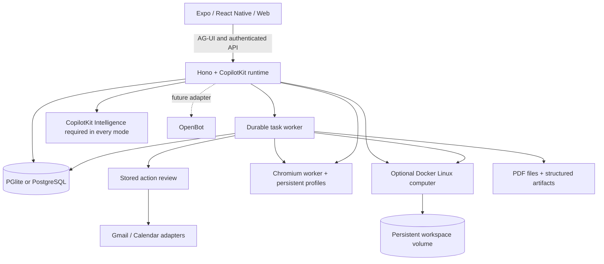

  <div align="center">

# LingWu

**你的个人投研智能体 —— 带着浏览器、终端与文件，持续工作。兼容任何智能体框架。**

Your personal investment agent — with a browser, terminal, files, and work that keeps going. Compatible with any agent harness.

Ask for an outcome. Follow the plan, review actions, and come back to the result.
Built with CopilotKit React Native for iOS, Android, and web.

[Quick start](#quick-start) · [个人投研智能体](#个人投研智能体) · [Demo](#demo) · [Features](#features) · [Architecture](#architecture) · [Wiki](docs/WIKI.md) · [Docs](docs/README.md) · [Contributing](CONTRIBUTING.md)

[](https://github.com/quncezhineng/lingwu/actions/workflows/ci.yml)
[](LICENSE)

<a href="https://trendshift.io/repositories/254992?utm_source=trendshift-badge&amp;utm_medium=badge&amp;utm_campaign=badge-trendshift-254992" target="_blank" rel="noopener noreferrer"></a>

[](https://render.com/deploy?repo=https://github.com/quncezhineng/lingwu)

Clone this template and customize it however you want.

</div>

> **Alpha, for self-hosting and building on.** Open-ended reasoning, live Google accounts, and CopilotKit Rich Threads require their own configuration. See [what is verified](docs/VERIFICATION.md) and the [roadmap](ROADMAP.md).

## 个人投研智能体

**灵悟把“研究一只股票”从一次问答，变成一条可以被查看、继续和复用的工作流。**

它不是只负责聊天的股票机器人，而是一名带着行情、浏览器、文件、任务队列和长期记忆工作的投研助理。你可以让它每天生成市场简报、研究一个标的、导入并分析持仓、在价格或公开页面发生变化时提醒你，也可以让多个专业 Agent 围绕一个复杂问题分工、互相等待依赖，最后汇总成一份完整报告。

### 投研闭环

| 环节 | 用户看到什么 | 系统在后台做什么 |
| --- | --- | --- |
| **观察** | 自选行情、涨跌幅、持仓市值 | 拉取 Yahoo/AKShare 行情，合并缓存，标记过期数据 |
| **记忆** | 偏好、论点、分析、决策 | 按账户、Agent、频道隔离保存，并双写 Hindsight |
| **分析** | 每日简报、单标的研究、组合风险 | 执行简报生成、研究任务和组合指标计算 |
| **交付** | 对话卡片、研报、文件、分享链接 | 保存结构化产物，支持导出和网页打印 PDF |
| **跟踪** | 价格提醒、网页监控、论点周检 | SQL 租约调度后台任务，去重通知并处理失败退避 |

### 已经落地的投研能力

| 能力 | 当前体验 |
| --- | --- |
| **每日市场简报** | 汇总标普 500、纳斯达克、道指、上证、深证与自选标的异动；支持定时、手动生成、补跑和失败重试 |
| **观察列表** | 多列表管理；添加 A 股、港股、美股标的；批量行情摘要；日涨跌幅超过 2% 标记为异动 |
| **深度研究** | 对单个标的生成行情、新闻、同业和启发式估值报告；产物可查看、分享、导出 |
| **投资组合** | CSV 导入或手工录入；按币种计算成本、市值、浮动盈亏、配置和风险指标 |
| **投资笔记与论点** | 记录买入/卖出理由、研究笔记和论点；每周生成幂等回检记录与提醒 |
| **价格与网页监控** | 价格高于/低于、涨跌幅阈值；公开页面内容变化、文本出现、价格阈值 |
| **多 Agent 协作** | 8 种专家模板；频道内 2–10 名 Agent；DAG 编排、依赖解锁、失败传播和汇总 |
| **长期记忆** | 账户共享、Agent 私有、频道共享三档作用域；支持金融术语和投融资阶段字段 |
| **可信交付** | 邮件/日历外部写入必须人工审核；分享链接；报告与文件可追溯 |

### 重要的能力边界

- 研究是**投研底稿**，不是完整卖方研报：当前不包含完整三大报表、一致预期和 DCF。
- 论点周检会提示“待人工确认”，不会用模型伪造成立或不成立。
- 组合按人民币、美元、港币分别汇总，不做未经确认的汇率折算。
- 市场简报的“今日事件”尚未接入，空事件不代表今天没有事件。
- 当前是应用内通知，设备推送、公告事件流和交易日历仍在规划中。
- 产品不提供买卖建议、收益承诺或交易执行。

完整的产品定义、工作流、数据模型、API 与实现边界见 **[个人投研智能体：产品与架构全景](docs/个人投研智能体.md)**，工程与部署问题见 **[项目 Wiki](docs/WIKI.md)**。

## Demo

On iPhone, ask LingWu to find interesting stories on Hacker News and summarize CopilotKit. On desktop, ask it to check the school-trip email, open the message, and research exhibits at Monterey Bay Aquarium. The agent shows email and browser results inline. **Take control** opens that same browser session when you need it.

The 38-second iPhone and 42-second desktop web demos show the current interface, framed in 16:9. The send arrow becomes a stop square inside the input pill while the agent replies, then switches back. Stopping keeps your draft intact. See the [recording notes](docs/DEMO.md) for the model setup and reproduction steps.

[Mobile MP4](https://github.com/user-attachments/assets/8014d185-346c-4954-8ff0-26c582c5093a) · [Web MP4](https://github.com/user-attachments/assets/0cc87de0-c3c1-4f24-b7df-e7d04bb946fd) · [Recording details and reproduction](docs/DEMO.md)

The [Jev aquarium-trip demo](docs/demos/jev-generative-ui.md) walks through a fictional school email, clarification choices, sourced exhibit cards, hands-on preference refinement, and a confirmed selection. [Watch the 83-second live Jev recording](assets/demos/2026-09-23/jev-live-web.mp4), where TypeSafe Jev makes the decisions and a scripted agent keeps the trip scenario repeatable. A [scripted-decision sample recording](assets/demos/2026-09-23/jev-web.mp4) is also available.

## What it is

LingWu is a **personal investment research agent** built on a general-purpose agent runtime. It combines market data, portfolio tracking, research reports, long-term memory, durable jobs, persistent Chromium, and an optional Linux workspace in one application. It runs its own server, task worker, and browser worker; the source is inspectable and modifiable under the MIT license.

The investment layer covers US, Hong Kong, and mainland China symbols, daily briefings, watchlists, CSV portfolios, risk metrics, price alerts, public-page watches, investment notes, and multi-agent research. The underlying agent runtime keeps the work visible: plans, missing-input requests, approvals, failures, receipts, and saved artifacts remain available after the app closes.

The computer combines **persistent Chromium and an optional Linux workspace**. The agent can browse public pages, run commands in its own container, work with files, and move PDFs between the computer and the app. You can open its browser or terminal and continue the work. Graphical desktops and autonomous checkout remain future work.

## Features

| Surface              | What runs in this alpha                                                                                                                                                                                                             |
| -------------------- | ----------------------------------------------------------------------------------------------------------------------------------------------------------------------------------------------------------------------------------- |
| **Chat**             | CopilotKit headless chat with streamed AG-UI events, mailbox search and reading, send/stop in one input pill, a visible follow-up queue, retained drafts, delegated tasks, and inline email, browser, PDF, plan, and finance cards. |
| **Agent computer**   | Persistent browser profiles and takeover console; optional isolated Linux terminal, saved command receipts, editable workspace files, and PDF transfer.                                                                             |
| **Activity**         | Durable task plans, progress, input requests, pause/resume/cancel/retry, approvals, and saved receipts. SQL leases recover interrupted work.                                                                                        |
| **Ideas**            | Suggestions with source evidence; edit, accept, or dismiss. Sent replies and completed matching work are excluded.                                                                                                                  |
| **Goals & Tracking** | Goals and milestones; recurring public-page checks for changes, text availability, or CNY/HKD/USD price thresholds, with deduplicated alerts and failure backoff.                                                                  |
| **Documents**        | Email attachment → PDF → requested form values → filled copy → reviewed reply → receipt. Native/web PDF viewing, paging, zoom, supported fields, and sharing.                                                                       |
| **Finance**          | Import transaction CSV to create a spending summary with categories, transactions, and a savings-goal action.                                                                                                                       |
| **Gmail & Calendar** | Google OAuth adapters, complete mail threads, drafts/attachments, calendar discovery, and reviewed event creation/update/deletion. Live credentials required.                                                                       |
| **Personal context** | Editable name, tone, avatar, and memories. Background-update preferences and durable in-app notifications.                                                                                                                          |
| **Rich Threads**     | CopilotKit Intelligence persistence in every mode, with a stable main conversation, side chats, renaming, archiving, restoring, and replay. A server-only project key is required.                                                  |

The investment capabilities above are the primary product surface. The [feature inventory](docs/FEATURES.md) describes the underlying general-agent capabilities and planned extensions; [personal investment agent](docs/个人投研智能体.md) is the authoritative status map for research, portfolio, monitoring, memory, and multi-agent workflows. Health/bank/social connectors, device push, voice, generated executable tools, and automatic reservations/payments are on the [roadmap](ROADMAP.md).

## Quick start

**Requirements:** Node 24 LTS, pnpm 11.19.0, and a CopilotKit Intelligence project key. The local sample app needs no model, Google account, or Docker.

```sh
git clone https://github.com/quncezhineng/lingwu.git lingwu
cd lingwu
pnpm install --frozen-lockfile
cp .env.example .env
npx copilotkit@latest login
npx copilotkit@latest project select
# Set CPK_INTELLIGENCE_API_KEY in .env to the generated server-only project key.
# Keep the CLI-generated CPK_TELEMETRY_ID too, including in deployed server environments.
pnpm dev
```

In another terminal:

```sh
pnpm dev:web
```

Open [localhost:8081](http://localhost:8081). The API runs at [localhost:8787/api/health](http://localhost:8787/api/health).

### Try it

1. Open **Watchlist** and add `AAPL`, `600519`, or `0700.HK`. Load the quote summary and open the symbol page.
2. Generate today's **market briefing** and inspect the index table, watchlist movers, and partial-data notice.
3. Ask **“Research AAPL”** and open the saved research-report artifact.
4. Create a **portfolio**, import a small holdings CSV, and compare allocation, P&L, and risk across currency buckets.
5. Create a **price alert** and use **Check now** to verify trigger and notification deduplication.
6. Ask **“Complete the permission slip”** to inspect a durable document task, supply fictional form values, and review the prepared reply.
7. Start the [browser worker](#browser-worker) and configure a model, then ask **“Check out Hacker News for cool stuff”** or **“Summarize copilotkit.ai”**. Follow the browser inline and use **Take control** to open its session.

For a model-free version of the browser flow, follow the [AI Mock demo setup](docs/DEMO.md#run-the-agent-browser-demo).

For iOS or Android, use `pnpm --dir apps/mobile ios` or `pnpm --dir apps/mobile android`. Xcode or Android tooling is required. The PDF reader needs an Expo development build; use [native setup](apps/mobile/README.md).

## Deploy on Render

[](https://render.com/deploy?repo=https://github.com/quncezhineng/lingwu)

[render.yaml](render.yaml) deploys three services: the API, the web app, and a private browser. The API answers `/` with JSON, so the UI is its own static site.

### First run

1. Click **Deploy to Render**. Wait until `lingwu-api`, `lingwu-web`, and `lingwu-browser` are live.
2. On `lingwu-api`, open **Environment** and copy `LINGWU_ACCESS_KEY`.
3. Open the `lingwu-web` URL and sign in with that key.
4. Send a message.

The deploy form asks for three values you provide. Render generates the other two.

| Variable                                                          | Set by                                                                                                                                                                              | If it is missing                                                       |
| ----------------------------------------------------------------- | ----------------------------------------------------------------------------------------------------------------------------------------------------------------------------------- | ---------------------------------------------------------------------- |
| `CPK_INTELLIGENCE_API_KEY`                                        | You. Run `npx copilotkit@latest login`, then `npx copilotkit@latest project select`. Keep it on the server.                                                                         | Chat cannot open a thread.                                             |
| `CPK_TELEMETRY_ID`                                                | You. Keep the identity generated by the same project selection.                                                                                                                     | Runtime usage cannot be attributed to the Intelligence signup account. |
| `OPENAI_API_KEY`                                                  | You. Used by the default `openai/gpt-5`. Change `MODEL` and supply the matching provider key for Anthropic, Google, DeepSeek (`DEEPSEEK_API_KEY`) or Moonshot (`MOONSHOT_API_KEY`). | The model call fails.                                                  |
| `LINGWU_ACCESS_KEY`                                               | Render                                                                                                                                                                              | You cannot sign in. Only used when the Supabase variables are unset.   |
| `TOKEN_ENCRYPTION_KEY`                                            | Render                                                                                                                                                                              | The API refuses to start in live mode.                                 |
| `SUPABASE_URL`, `SUPABASE_PUBLISHABLE_KEY`, `SUPABASE_SECRET_KEY` | You                                                                                                                                                                                 | Optional. Unset means one shared key and one owner per deployment.     |

Health check: `https://<lingwu-api>/api/health`.

### User accounts

Set `SUPABASE_URL`, `SUPABASE_PUBLISHABLE_KEY`, and `SUPABASE_SECRET_KEY` to turn the deployment into a multi-user workspace:

1. Create a Supabase project (or reuse one) and copy **Project URL**, **anon public**, and **service_role** from **Project Settings → API**.
2. Set the three variables on `lingwu-api` and restart it. `/api/health` then reports `"authMode": "supabase"`, and the app shows an email sign-in screen instead of the access-key field.
3. Run [supabase/migrations/0001_accounts.sql](supabase/migrations/0001_accounts.sql) in the Supabase SQL Editor (or `supabase db push`). It creates the profile, audit-log, and resource-index tables, the private avatar bucket, and a trigger that seeds a profile row for every new sign-up.
4. Each visitor registers with an email and password. The account lives in Supabase Auth (`auth.users`), with a matching row in `public.user_profiles`.
5. Every workspace record is stored under that account's id, so conversations, files, drafts, and Google connections are private to whoever signed in.
6. Keep `SUPABASE_SECRET_KEY` on the server only. It is never sent to the app.

Leaving the three variables unset keeps the original single-owner behaviour, so one deployment can still be a personal workspace.

### Services

| Service          | Plan                                            | What it runs                                                                   |
| ---------------- | ----------------------------------------------- | ------------------------------------------------------------------------------ |
| `lingwu-api`     | Standard, with a 1 GB disk at `/var/data`       | The Hono API and the in-process task worker. `DATA_DIR` is `/var/data/lingwu`. |
| `lingwu-web`     | Static site                                     | The Expo web export. `EXPO_PUBLIC_API_URL` is baked in at build time.          |
| `lingwu-browser` | Private service, Standard, 1 GB disk at `/data` | Playwright and Chromium. The API calls it on the private network.              |

**Standard** is the smallest plan that stays up. At 512 MB the process runs out of memory before it binds a port, because PGlite loads an embedded Postgres build.

**The disk** holds the database, PDFs, and the signing key. A redeploy without it wipes that data. Chat threads are stored by CopilotKit Intelligence, so a thread can still load after you sign back in even when the disk was never attached.

**Live mode** is required. Render binds `0.0.0.0`, and sample mode rejects any host that is not loopback. The Blueprint sets `WORKSPACE_MODE=live`.

**Browsing is included, and you can take it out.** `lingwu-browser` is a private service, so it has no public URL. The API reaches it at `http://lingwu-browser:8790` with a token Render generates. If the private hostname is not `lingwu-browser`, set `BROWSER_WORKER_URL` to `http://<that-host>:8790`. To deploy without it, delete the `lingwu-browser` service and the `BROWSER_WORKER_URL` and `WORKER_TOKEN` entries on `lingwu-api`. Chat, drafts, and tasks still run. Page reads, screenshots, and **Take control** do not.

The Docker computer and Google mail or calendar need the setup in the sections below. This Blueprint does not start them.

## Configure the agent and Google

Copy the commented settings in [.env.example](.env.example) into your private `.env`:

1. Set `AGENT_BACKEND=model`, `MODEL=provider/model-id`, and the matching provider key for a deployment default. Supported providers are OpenAI, Anthropic, Google, DeepSeek and Moonshot. With `TOKEN_ENCRYPTION_KEY` configured, users can select a provider and model from dropdowns and enter their own API Key in **My → Settings → Model connection** (DeepSeek first). Provider endpoints and model parameters are shared server configuration. Keys are encrypted on the server and never returned to the app. Personal connections and **Apps → Model** selections are isolated by account and survive restarts. See [personal model connections](docs/USER-MODEL-CONNECTION.md).
2. Create or select a CopilotKit Intelligence project with `npx copilotkit@latest login` and `npx copilotkit@latest project select`. Keep the generated `CPK_INTELLIGENCE_API_KEY` on the server.
3. For personal mail/calendar, set `WORKSPACE_MODE=live`, the generated `CPK_INTELLIGENCE_API_KEY`, and `TOKEN_ENCRYPTION_KEY` containing 32 random bytes encoded as base64. Then pick one sign-in model: the three [Supabase variables](#user-accounts) for one account per person, or a random `LINGWU_ACCESS_KEY` of at least 24 characters for a single shared key. Restart the API.
4. Configure a Google OAuth web client with Gmail and Calendar APIs enabled. Set `GOOGLE_CLIENT_ID` and `GOOGLE_CLIENT_SECRET`; register `${PUBLIC_API_URL}/api/google/callback` as its redirect URI. Configure consent/test-user access in your Google project.
5. Open **Apps → Gmail** (or **Google Calendar**), connect read access, and grant write access when needed. Every send or calendar change still requires its own stored review. Changing/disconnecting the account invalidates pending connection-bound work.

Google credentials are encrypted at rest. File URLs and browser consoles use short-lived signatures. This deployment uses one owner protected by a shared access key; it is not a multi-tenant authentication system. Use HTTPS and restricted network access for a remote host. Keep the default local-data mode on loopback.

## Public web search

Web search is enabled by default. Set `WEB_SEARCH_ENABLED=false` on the API and any separate task worker to disable it. With a configured model, delegated tasks and built-in model chat (`AGENT_BACKEND=model`) use [Parallel's free, keyless Search MCP](https://docs.parallel.ai/integrations/mcp/search-mcp) as their built-in search provider. Ask, for example, “Find the official CopilotKit React Native setup instructions and cite the sources.” Results include source URLs and excerpts; delegated tasks save them as evidence. Scripted sample chat and external AG-UI conversations keep their existing tools.

Search sends model-generated queries and context, which may include information from your conversation or task, plus a random per-chat/task session identifier to Parallel. See [Parallel's privacy policy](https://parallel.ai/privacy-policy). Free access is rate limited; failures are reported without a paid fallback. Stopping chat or interrupting a task cancels its search.

## Browser worker

Set `BROWSER_WORKER_URL=http://127.0.0.1:8790` and a random `WORKER_TOKEN` of at least 32 characters in `.env`.

```sh
pnpm --dir apps/worker exec playwright install chromium
pnpm dev:browser
```

Or use `docker compose --env-file .env -f infra/compose.yaml up --build -d`. The same token must reach the API and worker. Sessions have persistent Chromium profiles; the app can open a live screenshot console and import PDF downloads. Agent tools can read public pages and hand interactive work to the person. [Worker setup and boundaries](apps/worker/README.md).

## Persistence and operation

### Linux terminal and workspace

Build the computer image, enable it on the API, then open **Computer → Terminal → Start computer**:

```sh
docker build -t lingwu-computer:local apps/computer
COMPUTER_ENABLED=true pnpm dev
```

The API needs access to the Docker CLI and engine. Commands run in a nonroot container with no host-directory mounts or credentials. A named `/workspace` volume retains files when stopped. Terminal networking is disabled; public web access uses the browser worker. Commands have a 30-second limit and saved output/exit receipts. **Files** supports folders, text editing, and PDF transfer to/from Documents. This is a Linux container, not a full operating-system VM. [Setup, Colima option, and boundaries](docs/COMPUTER.md).

### Application storage

By default, embedded PGlite, documents and the signing key live in `.lingwu/`; browser profiles live in `.lingwu/browser-profiles/`. Keep that directory private and back it up. The API hosts the task worker. The host must remain running for background work.

For a separate task worker, configure the same `DATABASE_URL`, secrets and shared `DATA_DIR` for both processes, then set `TASK_WORKER_ENABLED=false` on the API and run `pnpm dev:worker`. PGlite cannot be opened by separate processes. Production commands are `pnpm build:server`, `pnpm start` and `pnpm start:worker`. Run one API instance; task workers coordinate through SQL leases.

No hidden retry occurs after an uncertain external write. Review its provider outcome before creating a replacement. Pausing/cancelling prevents subsequent task steps; an already approved in-flight provider request may finish.

## CopilotKit Rich Threads

Every deployment requires `CPK_INTELLIGENCE_API_KEY` on the API server for CopilotKit Intelligence conversation persistence and replay. Create or select a project with `npx copilotkit@latest login` and `npx copilotkit@latest project select`, set the generated server-only key, and restart the API. The native menu uses `useThreads`; rich tool results link back to saved tasks, documents, and browser sessions.

Intelligence is a separate service and is not included in this repository's MIT license. No project key is shipped. [Configuration and validation boundaries](docs/RICH-THREADS.md).

## Signup and runtime tracking

The CopilotKit SDK sends runtime telemetry through the shared CopilotKit sink to PostHog with `accessibility_title: "LingWu"`. Telemetry defaults to full capture; explicit SDK opt-outs and sampling settings take precedence. Keep the CLI-generated `CPK_TELEMETRY_ID` alongside the server-only project key when deploying. Intelligence records completed account signups separately; LingWu runtime usage can be joined to those accounts after the sink resolves the identity. [Setup, opt-out and PostHog validation](docs/TELEMETRY.md).

## Architecture



| Directory               | Purpose                                                                                   |
| ----------------------- | ----------------------------------------------------------------------------------------- |
| `apps/mobile`           | Shared iOS, Android, and web UI with CopilotKit headless hooks.                           |
| `apps/server`           | API, CopilotKit runtime, identity boundary, task engine, reviews, files, and persistence. |
| `apps/worker`           | Token-protected Playwright browser service with persistent profiles.                      |
| `apps/computer`         | Nonroot Linux image, bounded filesystem helper, and real container verification.          |
| `packages/domain`       | Shared types and request validation.                                                      |
| `packages/integrations` | Google and browser protocol adapters.                                                     |
| `packages/backends`     | Optional OpenBot HTTP adapter and its identity boundary.                                  |
| `tests`                 | Workflow, runtime, persistence, provider-contract, and authorization tests.               |

### OpenBot compatibility

LingWu's native client and personal-agent workflows are independent of OpenBot. The disabled OpenBot adapter is pinned and contract-tested against upstream interfaces. Live user/session bridging, routine mapping, and computer backend wiring remain future work. OpenBot's Intelligence runtime is not a raw AG-UI endpoint. [Integration contract](docs/OPENBOT-INTEGRATION.md).

## Development

```sh
pnpm lint
pnpm typecheck
pnpm test
pnpm build:server
pnpm build:web
pnpm build:ios
pnpm build:android
pnpm --dir apps/worker typecheck
pnpm test:browser
pnpm test:computer
```

Platform build scripts export JavaScript/Hermes bundles; they do not produce signed app binaries. Browser checks use controlled HTTP fixtures; the local check requires installed Chromium, and the container check requires Docker and registry access to build its image. CI also exercises the browser and Linux computer containers. See [contribution guidance](CONTRIBUTING.md) and [verification results](docs/VERIFICATION.md).

## Contributing and license

Issues and pull requests are welcome. Start with [CONTRIBUTING.md](CONTRIBUTING.md), [ROADMAP.md](ROADMAP.md), and the [security policy](SECURITY.md).

MIT licensed. Built by CopilotKit. Its original interface and fictional assets are included. Website, email, and document content supplies evidence, not permission to act.
