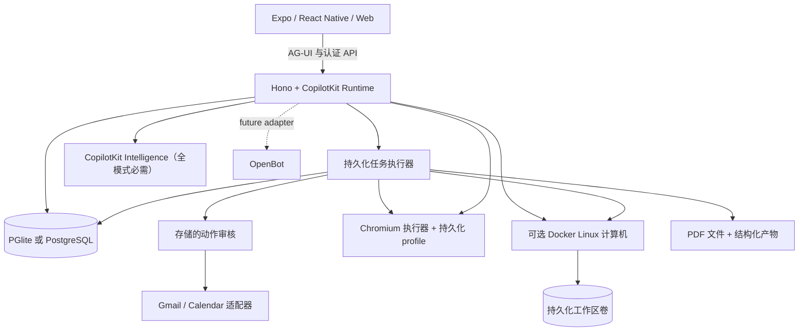

# LingWu 项目 Wiki

> 你的个人投研智能体 —— 带着浏览器、终端与文件，持续工作。兼容任何智能体框架。
>
> Your personal investment research agent — with a browser, terminal, files, and work that keeps going. Compatible with any agent harness.

**版本**: 0.1.0-alpha (2026-09-15) · **协议**: MIT · **构建**: CopilotKit React Native + AG-UI

---

## 1. 项目概述

LingWu 是一个个人智能体（personal agent）应用，核心特点在于「可见的工作过程」和「丰富的成果呈现」。它拥有自己的服务器、任务执行器与浏览器执行器，用户可检查并修改其源码（MIT 协议）。

**核心能力**：向它提出一个目标，它会制定计划、执行动作、汇报进度，最终带回结果。整个执行过程（计划、审批、动作、成果）都对用户可见、可干预。

**技术栈**：

| 层       | 技术                                                      |
| -------- | --------------------------------------------------------- |
| 客户端   | Expo / React Native（iOS、Android、Web 三端）             |
| UI 框架  | CopilotKit React Native（headless hooks）+ AG-UI 流式事件 |
| 服务端   | Hono + CopilotKit Runtime                                 |
| 持久化   | PGlite（嵌入式 Postgres）或 PostgreSQL                    |
| 浏览器   | Playwright + Chromium（持久化 profile）                   |
| 容器     | Docker（可选的 Linux 计算机）                             |
| 类型校验 | Zod                                                       |

**前置要求**：Node 24 LTS、pnpm 11.19.0、CopilotKit Intelligence 项目密钥。

---

## 2. 功能清单

| 功能面                | 说明                                                                                                                                                    |
| --------------------- | ------------------------------------------------------------------------------------------------------------------------------------------------------- |
| **Chat（对话）**      | CopilotKit headless 对话，流式 AG-UI 事件；邮箱搜索与阅读；单按钮发送/停止；可见的后续任务队列；草稿保留；任务委派；内联邮件/浏览器/PDF/计划/财务卡片。 |
| **Agent 计算机**      | 持久化浏览器 profile 与接管控制台；可选隔离 Linux 终端；命令回执；可编辑工作区文件；PDF 传输。                                                          |
| **Activity（活动）**  | 持久化任务计划、进度、输入请求、暂停/恢复/取消/重试、审批、保存的回执。SQL 租约可恢复被中断的工作。                                                     |
| **Ideas（想法）**     | 带来源证据的建议；可编辑、采纳或忽略；已发送的回复和已完成的工作会被排除。                                                                              |
| **Goals & Tracking**  | 目标与里程碑；周期性公共页面检查（内容变化、文本可用性、USD 价格阈值），去重告警与失败退避。                                                            |
| **Documents（文档）** | 邮件附件 → PDF → 表单值 → 填写副本 → 审核回复 → 回执。原生/网页 PDF 查看、翻页、缩放、字段支持与分享。                                                  |
| **Finance（财务）**   | 导入交易 CSV，生成带分类、交易明细和储蓄目标动作的消费汇总。                                                                                            |
| **Gmail & Calendar**  | Google OAuth 适配器、完整邮件线程、草稿/附件、日历发现、受审核的事件增删改。                                                                            |
| **个人上下文**        | 可编辑的姓名、语气、头像与记忆；后台更新偏好与持久化应用内通知。                                                                                        |
| **Rich Threads**      | CopilotKit Intelligence 持久化（全模式），稳定主对话、侧聊、重命名、归档、恢复与回放。                                                                  |

> 健康/银行/社交连接器、设备推送、语音、生成式可执行工具、自动预约/支付等功能仍在 [路线图](ROADMAP.md) 中。

---

## 3. 架构



### 目录结构

| 目录                    | 用途                                                              |
| ----------------------- | ----------------------------------------------------------------- |
| `apps/mobile`           | 共享的 iOS、Android、Web UI，使用 CopilotKit headless hooks。     |
| `apps/server`           | API、CopilotKit Runtime、身份边界、任务引擎、审核、文件与持久化。 |
| `apps/worker`           | Token 保护的 Playwright 浏览器服务，带持久化 profile。            |
| `apps/computer`         | 非 root Linux 镜像、受限文件系统助手与真实容器验证。              |
| `packages/domain`       | 共享类型与请求校验。                                              |
| `packages/integrations` | Google 与浏览器协议适配器。                                       |
| `packages/backends`     | 可选 OpenBot HTTP 适配器及其身份边界。                            |
| `tests`                 | 工作流、运行时、持久化、provider 契约与授权测试。                 |

---

## 4. 快速开始

```sh
git clone https://github.com/quncezhineng/lingwu.git lingwu
cd lingwu
pnpm install --frozen-lockfile
cp .env.example .env
npx copilotkit@latest login
npx copilotkit@latest project select
# 在 .env 中设置 CPK_INTELLIGENCE_API_KEY 为生成的服务端项目密钥
# 同时保留 CLI 生成的 CPK_TELEMETRY_ID（部署环境同样需要）
pnpm dev
```

在另一个终端：

```sh
pnpm dev:web
```

- 打开 [localhost:8081](http://localhost:8081)
- API 运行于 [localhost:8787/api/health](http://localhost:8787/api/health)

### 体验步骤

1. **Chat** 中发送 "Complete the permission slip"，打开任务、填写虚构表单值、查看生成的 PDF、审核回复。
2. **Goals → Track** 中创建内置可用性监控，修改内置测试页触发告警。
3. **Menu → Delegate task → Finance** 使用 "Try example transactions" 创建交互式消费追踪器。
4. 启动浏览器执行器并配置模型，询问 "Check out Hacker News for cool stuff"，用 **Take control** 打开其会话。

---

## 5. 环境变量

关键配置项（完整注释见 `.env.example`）：

| 变量                                                                | 说明                                                   |
| ------------------------------------------------------------------- | ------------------------------------------------------ |
| `CPK_INTELLIGENCE_API_KEY`                                          | CopilotKit Intelligence 服务端项目密钥（必填，全模式） |
| `CPK_TELEMETRY_ID`                                                  | 运行时遥测身份标识                                     |
| `MODEL`                                                             | 默认模型（如 `openai/gpt-5`）                          |
| `OPENAI_API_KEY` / `DEEPSEEK_API_KEY` / `MOONSHOT_API_KEY`          | 各 provider 密钥                                       |
| `AGENT_BACKEND`                                                     | `model` 或示例模式                                     |
| `WORKSPACE_MODE`                                                    | `live`（生产）或示例模式                               |
| `TOKEN_ENCRYPTION_KEY`                                              | 32 随机字节的 base64 编码                              |
| `LINGWU_ACCESS_KEY`                                                 | 单租户共享访问密钥（未设 Supabase 时使用）             |
| `SUPABASE_URL` / `SUPABASE_PUBLISHABLE_KEY` / `SUPABASE_SECRET_KEY` | 多用户工作区（可选）                                   |
| `BROWSER_WORKER_URL` / `WORKER_TOKEN`                               | 浏览器执行器地址与令牌                                 |
| `COMPUTER_ENABLED`                                                  | 启用 Docker Linux 计算机                               |
| `WEB_SEARCH_ENABLED`                                                | 是否启用公共网页搜索（默认 true）                      |

---

## 6. 部署

### Render 部署

[render.yaml](render.yaml) 部署三个服务：

| 服务             | 计划                                                                                                                       | 运行内容                    |
| ---------------- | -------------------------------------------------------------------------------------------------------------------------- | --------------------------- |
| `lingwu-api`     | Standard，1 GB 磁盘 `/var/data`                                                                                            | Hono API 与进程内任务执行器 |
| `lingwu-web`     | 静态站点                                                                                                                   | Expo Web 导出               |
| `lingwu-browser` | 私有服务，Standard，2 GB 磁盘 `/data`（持久化 Chromium profile 与已下载 PDF，1 GB 会写满导致启动崩溃，见下方「部署」章节） | Playwright 与 Chromium      |

**注意**：Standard 是最小可用计划（512 MB 会因 PGlite 加载嵌入式 Postgres 而内存不足）。磁盘保存数据库、PDF 与签名密钥，重新部署不挂载会清空数据。**必须启用 live 模式**（`WORKSPACE_MODE=live`）。

### 多用户账户

设置 Supabase 三变量后，执行 `supabase/migrations/0001_accounts.sql`，即可将部署转为多用户工作区（邮箱密码注册，数据按账户隔离）。

---

## 7. 开发

```sh
pnpm lint            # biome 检查
pnpm typecheck       # TypeScript 类型检查
pnpm test            # 单元/工作流测试
pnpm build:server    # 构建服务端
pnpm build:web       # 构建 Web
pnpm build:ios       # 导出 iOS bundle
pnpm build:android   # 导出 Android bundle
pnpm --dir apps/worker typecheck
pnpm test:browser    # 浏览器生命周期测试
pnpm test:computer   # Linux 计算机冒烟测试
```

> 平台构建脚本导出 JavaScript/Hermes bundle，不生成签名二进制。浏览器测试使用受控 HTTP fixture；本地检查需安装 Chromium，容器检查需 Docker 与镜像仓库访问。

---

## 8. 关键子模块说明

### 浏览器执行器（apps/worker）

Token 保护的 Playwright 服务，提供持久化 Chromium profile。API 通过私有网络调用。支持读取公共页面、截图、人工交互（Take control）、PDF 下载。启动：

```sh
pnpm --dir apps/worker exec playwright install chromium
pnpm dev:browser
# 或
docker compose --env-file .env -f infra/compose.yaml up --build -d
```

### Linux 计算机（apps/computer）

非 root 容器，无主机目录挂载或凭据。命名卷 `/workspace` 保留文件。终端网络已禁用（公共网页访问走浏览器执行器）。命令有 30 秒限制并保存输出/退出回执。

```sh
docker build -t lingwu-computer:local apps/computer
COMPUTER_ENABLED=true pnpm dev
```

### 任务执行器与持久化

默认嵌入式 PGlite、文档与签名密钥位于 `.lingwu/`，浏览器 profile 位于 `.lingwu/browser-profiles/`。任务执行器通过 SQL 租约协调（多进程时需共享 `DATABASE_URL` 与 `DATA_DIR`）。

---

## 9. OpenBot 兼容性

LingWu 的原生客户端与个人智能体工作流独立于 OpenBot。已禁用的 OpenBot 适配器已锁定版本并针对上游接口做契约测试。实时用户/会话桥接、例行任务映射与计算机后端接线仍是未来工作。

---

## 10. 文档索引

| 文档                                                   | 内容                           |
| ------------------------------------------------------ | ------------------------------ |
| [README.md](README.md)                                 | 项目主入口                     |
| [FEATURES.md](FEATURES.md)                             | 功能清单与扩展计划             |
| [COMPUTER.md](COMPUTER.md)                             | Linux 计算机、终端与工作区文件 |
| [RICH-THREADS.md](RICH-THREADS.md)                     | CopilotKit Rich Threads 配置   |
| [conversation-streaming.md](conversation-streaming.md) | 对话流式协议与可靠性           |
| [EXPERIENCE.md](EXPERIENCE.md)                         | 交互设计与对话行为             |
| [OPENBOT-INTEGRATION.md](OPENBOT-INTEGRATION.md)       | OpenBot 集成契约               |
| [I18N.md](I18N.md)                                     | 本地化与语言切换               |
| [TELEMETRY.md](TELEMETRY.md)                           | 遥测配置与退出                 |
| [VERIFICATION.md](VERIFICATION.md)                     | 验证结果与限制                 |
| [DEMO.md](DEMO.md)                                     | 演示复现步骤                   |
| [timeline.md](timeline.md)                             | 项目时间线                     |

---

## 11. 贡献与许可

- 提交 PR 前运行完整检查（lint、typecheck、test、各平台 build）。
- 架构/连接器级变更请先提 issue 讨论范围。
- 安全报告遵循 [SECURITY.md](SECURITY.md)。
- 项目采用 MIT 许可，由 CopilotKit 构建。
