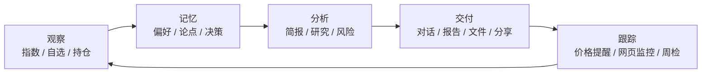
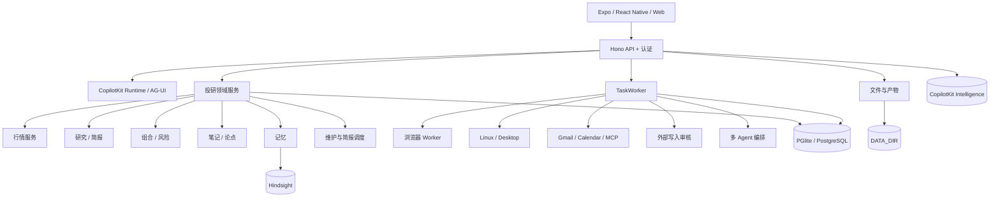

# LingWu（灵悟）项目 Wiki

> **你的个人投研智能体**：带着行情、浏览器、文件、任务队列和长期记忆持续工作。
>
> 项目主页：[README.md](../README.md) · 产品与架构全景：[个人投研智能体.md](个人投研智能体.md) · 文档索引：[README.md](README.md)

**当前版本**：`0.1.0-alpha` ｜ **更新时间**：2026-11-16 ｜ **许可证**：MIT

---

## 1. 项目一览

| 维度 | 内容 |
| --- | --- |
| **产品定位** | 面向个人投资者的 AI 投研助理，不是荐股机器人或交易终端 |
| **核心闭环** | 观察 → 记忆 → 分析 → 交付 → 跟踪 |
| **覆盖市场** | 美股、A 股、港股；A 股实时性依赖 AKShare |
| **主要入口** | 对话、标的页、自选与组合、每日简报、任务中心、资料库、频道 |
| **客户端** | Expo / React Native：iOS、Android、Web |
| **服务端** | Hono、CopilotKit Runtime、AG-UI、耐久任务引擎 |
| **存储** | PGlite（单机）或 PostgreSQL；业务记录为 JSONB 快照 |
| **执行环境** | Playwright 浏览器、可选 Linux/桌面计算机、MCP 连接器 |
| **模型** | OpenAI、Anthropic、Google、DeepSeek、Moonshot 等 |
| **账户** | Supabase 多用户，或单租户共享访问密钥 |

### 1.1 它擅长什么

- 把“研究一下某只股票”变成可追踪的耐久任务。
- 每天生成市场简报，汇总主要指数和自选标的异动。
- 导入持仓，按币种计算市值、盈亏、配置和风险。
- 把研究结论、偏好和决策沉淀为可检索记忆。
- 在频道里组织多个专业 Agent 分工完成复杂研究。
- 让浏览器、文件和任务结果进入同一条可复核的工作流。

### 1.2 它明确不做什么

- 不提供买卖建议或收益承诺。
- 不接入券商下单，不代用户交易。
- 不承诺交易所级实时行情。
- 不用示例数据冒充真实行情。
- 不绕过授权边界执行外部写入。

> 更完整的产品定义、能力矩阵和实现边界见 [个人投研智能体.md](个人投研智能体.md)。

---

## 2. 推荐阅读路径

### 2.1 第一次了解项目

1. 本页“项目一览”和“核心工作流”。
2. [个人投研智能体.md](个人投研智能体.md)：产品定义、用户场景、架构和 API。
3. [PRD-LingWu-个人投研智能体.md](PRD-LingWu-个人投研智能体.md)：P0/P1/P2 需求。
4. [ROADMAP.md](../ROADMAP.md)：后续扩展方向。

### 2.2 准备本地运行

1. 本页“快速开始”。
2. [BROWSER-WORKER-本地启动指南.md](BROWSER-WORKER-本地启动指南.md)：浏览器 Worker。
3. [COMPUTER.md](COMPUTER.md)：可选 Linux 计算机。
4. [USER-MODEL-CONNECTION.md](USER-MODEL-CONNECTION.md)：个人模型连接。
5. [RICH-THREADS.md](RICH-THREADS.md)：CopilotKit Intelligence 配置。

### 2.3 准备部署或排障

1. 本页“配置”和“部署”。
2. [O2-定时任务与部署手册.md](O2-定时任务与部署手册.md)：简报调度、AKShare、PDF 自检。
3. [行情数据缓存与降级策略.md](行情数据缓存与降级策略.md)：缓存、限流和降级。
4. [VERIFICATION.md](VERIFICATION.md)：当前验证范围。

---

## 3. 产品主线

### 3.1 一次完整的投研循环



这个循环比“问一个问题、得到一个答案”更重要。灵悟把一次研究产生的上下文留了下来，供下一次研究复用。

### 3.2 四类核心对象

| 对象 | 解决的问题 |
| --- | --- |
| **Task** | 把长任务交给后台，App 关闭后仍可继续，支持等待输入、审批、暂停和重试 |
| **Artifact** | 把研究过程变成可打开、可下载、可分享的成果 |
| **Memory** | 把用户偏好、论点和决策保留下来，减少重复解释 |
| **Monitor / Alert** | 把定时检查交给系统，不必手动刷新页面或行情 |

### 3.3 三种协作方式

| 方式 | 适用场景 |
| --- | --- |
| **单 Agent 对话** | 快速问答、单标的研究、创建提醒、继续已有任务 |
| **任务委派** | 需要长时间执行、使用浏览器/文件/连接器、可能中断后恢复 |
| **频道多 Agent 编排** | 需要多个专业视角、可拆分 DAG、最终汇总成长报告 |

---

## 4. 当前能力状态

图例：**已实现** = 主链路可用；**部分实现** = 可用但有明确边界；**规划中** = 尚未对外承诺。

| 能力面 | 状态 | 说明 |
| --- | --- | --- |
| 对话与流式回复 | 已实现 | CopilotKit headless、AG-UI 事件、停止与草稿保留 |
| 耐久任务 | 已实现 | SQL 租约、心跳、检查点、等待输入、审批、暂停、重试 |
| 每日市场简报 | 已实现 | 5 个主要指数 + 自选标的；按日幂等、补跑、最多 3 次尝试 |
| 观察列表 | 已实现 | 多列表、每列表最多 200 个标的、批量摘要、异动标记 |
| 行情数据 | 已实现 | Yahoo 为主，A 股回落 AKShare，新鲜/过期缓存降级 |
| 单标的研究 | 部分实现 | 行情、新闻、同业、区间启发式估值；不含完整财报/DCF |
| 投资组合 | 已实现 | CSV/手工导入、配置、盈亏、按币种风险指标 |
| 投资笔记 | 已实现 | 买入理由、卖出理由、研究、论点四类 |
| 论点周检 | 部分实现 | 幂等周检与通知；结论待人工确认 |
| 价格提醒 | 已实现 | 高于/低于/涨跌幅阈值，通知去重 |
| 网页监控 | 已实现 | 内容变化、包含文本、价格阈值；支持间隔/每日/每周 |
| 长期记忆 | 部分实现 | 作用域隔离、双写 Hindsight；对话召回以本地关键词为主 |
| 多 Agent 空间 | 已实现 | 空间最多 20 个 Agent（含 1 个系统 Agent），支持独立模型 |
| 频道协作 | 已实现 | 2–10 名成员，DAG 编排与汇总 |
| 技能库 | 已实现 | 184 条内置只读技能元数据 + 账户级自建 Markdown 技能 |
| 应用连接器 | 部分实现 | MCP、邮件、文件、台账等；部分 OAuth 仍需平台配置 |
| 浏览器 | 已实现（需配置） | 持久化 profile、页面读取、接管、PDF 下载 |
| 智能体计算机 | 已实现（可选） | Docker Linux 或 E2B Desktop，受限命令和持久工作区 |
| 文件与分享 | 已实现 | 上传、预览、HTML/Markdown 导出、打印 PDF、公开链接 |
| 多用户账户 | 已实现 | Supabase 邮箱登录、JWT 会话、远程登出、账户隔离 |
| 设备推送 | 规划中 | 当前仅应用内通知 |
| 事件日历/公告流 | 规划中 | 简报事件字段明确标记为未实现 |
| 交易执行 | 不做 | 不接券商下单 |

---

## 5. 快速开始

### 5.1 环境要求

- Node.js 22+，推荐 Node 24 LTS。
- pnpm `11.19.0`。
- CopilotKit Intelligence 项目密钥。
- 可选：Python 3 + AKShare、`pdftotext`、Chromium、Docker。

```bash
git clone https://github.com/quncezhineng/lingwu.git lingwu
cd lingwu
pnpm install --frozen-lockfile
cp .env.example .env
npx copilotkit@latest login
npx copilotkit@latest project select
# 将生成的 CPK_INTELLIGENCE_API_KEY 写入 .env；保留 CPK_TELEMETRY_ID
pnpm dev
```

另一个终端启动 Web：

```bash
pnpm dev:web
```

打开 `http://localhost:8081`；API 健康检查为 `http://localhost:8787/api/health`。

### 5.2 第一次投研体验

1. 打开观察列表，添加 `AAPL`、`600519` 或 `0700.HK`。
2. 回到工作台，加载行情摘要。
3. 点击“生成简报”或调用 `POST /api/briefings/generate`。
4. 创建“研究 AAPL”任务，打开研究报告产物。
5. 创建投资组合，导入一个最小持仓 CSV，查看分币种配置。
6. 新建一条价格提醒，使用“立即检查”验证触发和去重。
7. 打开 Agent 详情，查看记忆、任务和技能；有 Hindsight 时可观察写入。

### 5.3 可选依赖

**A 股实时链路**

```bash
python3 -m venv .venv
.venv/bin/pip install akshare
# .env
AKSHARE_PYTHON=.venv/bin/python
MARKET_DATA_AKSHARE_ENABLED=true
```

**财报 PDF 解析**

```bash
# macOS
brew install poppler
# Debian / Ubuntu
apt-get install -y poppler-utils
```

**浏览器 Worker**

```bash
pnpm --dir apps/worker exec playwright install chromium
pnpm dev:browser
```

`BROWSER_WORKER_URL=http://127.0.0.1:8790`，`WORKER_TOKEN` 至少 32 个字符。

**Linux 计算机**

```bash
docker build -t lingwu-computer:local apps/computer
COMPUTER_ENABLED=true pnpm dev
```

---

## 6. 核心概念

| 概念 | 定义 | 关键约束 |
| --- | --- | --- |
| **Agent** | 具有线程、人设、模型、技能和记忆作用域的智能体 | 空间总计最多 20 个；含 1 个系统 Agent |
| **Channel** | 多位 Agent 的协作空间 | 2–10 名成员；共享目标和指令 |
| **Task** | 耐久工作单元 | 状态机、租约、检查点、证据、产物 |
| **Orchestration** | 把顶层任务拆成 DAG | 最多 50 个节点；无环；依赖解锁 |
| **Artifact** | 结构化成果 | 报告、简报、比较、计划、财务、研究 |
| **Memory** | 长期记忆 | 账户 / Agent / 频道三档作用域 |
| **Watchlist** | 关注标的集合 | 单列表最多 200 个标的 |
| **Portfolio** | 手工维护的投资组合 | 不接券商；不做汇率折算 |
| **Monitor** | 周期性网页条件检查 | 不是交易所实时行情或交易日历 |
| **Price Alert** | 价格/涨跌幅阈值提醒 | 1–1440 分钟检查；24 小时去重 |
| **Thesis** | 可回检的投资论点 | 自动周检不替代人工结论 |

### 6.1 Agent 模板

系统内置 8 种非系统模板：行情、资产、研究、财报、宏观、风控、复盘、自定义。每个 Agent 可以：

- 选择独立模型。
- 配置人设、语气和沟通风格。
- 安装技能、引用自建技能。
- 拥有独立线程、任务和私有记忆。
- 在频道中被编排为 DAG 节点。

### 6.2 记忆作用域

```text
账户共享（default）
  ├─ 所有 Agent 可读
  ├─ Agent 私有（agentId）
  └─ 频道共享（channelId）
```

原则：

- 账户级偏好对任何 Agent 生效。
- Agent 私有记忆不跨 Agent 串味。
- 频道记忆只在该频道的编排任务中共享。
- 旧数据没有 `agentId` 时回退到 `default`。

---

## 7. 系统架构



### 7.1 目录结构

| 目录 | 职责 |
| --- | --- |
| `apps/mobile` | iOS、Android、Web UI；任务、标的、组合、频道、资料库、i18n |
| `apps/server` | API、运行时、认证、任务引擎、投研服务、文件、连接器 |
| `apps/worker` | Playwright 浏览器服务，持久化 profile |
| `apps/computer` | Linux 计算机镜像和工作区助手 |
| `packages/domain` | Agent、任务、投研、频道、编排等领域类型与校验 |
| `packages/integrations` | 行情、Google、PDF、凭据加密 |
| `packages/backends` | OpenBot 适配器 |
| `skills` | 184 个技能包，运行时只读取 Markdown 方法，不执行脚本 |
| `tests` | 1,100+ 单元、工作流、持久化、授权和 provider 契约测试 |
| `supabase` | 账户、分享、资源索引与审计迁移 |
| `infra` | Compose 与 Hindsight 编排 |

### 7.2 服务端关键模块

| 模块 | 职责 |
| --- | --- |
| `engine/worker.ts` | 任务租约、心跳、检查点、失败恢复 |
| `engine/service.ts` | 投研工作区、任务执行、记忆、监控、编排回调 |
| `engine/research.ts` | 单标的研究报告 |
| `engine/market-briefing.ts` | 每日简报生成 |
| `engine/briefing-scheduler.ts` | 按日幂等调度与重试 |
| `engine/watchlists.ts` | 观察列表与行情摘要 |
| `engine/price-alerts.ts` | 价格提醒检查与通知去重 |
| `engine/portfolios.ts` | CSV 导入、持仓与组合汇总 |
| `engine/portfolio-risk.ts` | Beta、Sharpe、波动、回撤、基准对比 |
| `engine/notes.ts` | 投资笔记与周检 |
| `engine/orchestrator.ts` | DAG 调度、依赖解锁、失败传播 |
| `engine/memory-scope.ts` | 账户/Agent/频道记忆作用域 |
| `engine/hindsight.ts` | Hindsight 写入、召回、删除客户端 |
| `packages/integrations/market-data.ts` | 行情 provider、缓存、降级与历史数据 |

---

## 8. 核心运行链路

### 8.1 对话到任务

```text
用户消息
  → CopilotKit/AG-UI
  → 模型选择工具
  → delegate_task / research_stock / watch_page
  → AgentTask 落盘
  → TaskWorker 领取
  → 执行、检查点、等待输入/审批
  → 产物 + 通知 + 回执
```

### 8.2 每日简报

```text
60 秒维护循环
  → 简报调度器
  → 检查有观察列表的 owner
  → 当天是否已有活动/成功任务
  → 创建 market_briefing 任务
  → 拉取指数和自选行情
  → 生成 3–5 条要点
  → 保存简报与产物
```

默认 UTC `00:00`，即北京时间 `08:00`。必须设置 `BRIEFING_SCHEDULE_ENABLED=true`。

### 8.3 单标的研究

```text
标的代码
  → 获取报价
  → 查询名称/行业
  → 搜索近期新闻
  → 固定同业组报价
  → 52 周区间启发式估值
  → 六段式报告
  → research_report 产物
```

研究任务在报价获取失败时会直接失败；新闻、同业等子数据源失败则独立降级。

### 8.4 多 Agent 编排

```text
频道请求
  → 编排者生成 DAG
  → 入度 0 节点入队
  → 子任务完成
  → 下游解锁
  → 全部终态
  → 汇总 Agent 合并
  → 综合研报 + 共享产物
```

失败策略是 fail-fast：失败节点的下游标记为 `skipped`，顶层任务失败并只发送一条汇总通知。

### 8.5 外部写入

```text
模型准备邮件/日程
  → 服务端保存审核单
  → 用户在原生界面确认
  → 执行器调用外部服务
  → 保存成功/失败/结果未知回执
```

模型不能自行批准，也不会在不确定结果后自动重试外部写入。

---

## 9. 配置与部署

完整示例见 [.env.example](../.env.example)。

### 9.1 必填

| 变量 | 说明 |
| --- | --- |
| `CPK_INTELLIGENCE_API_KEY` | CopilotKit Intelligence 服务端项目密钥 |
| `CPK_TELEMETRY_ID` | CLI 生成的遥测身份 |
| `MODEL` | 默认模型，例如 `openai/gpt-5` |
| 对应 provider key | `OPENAI_API_KEY`、`ANTHROPIC_API_KEY`、`GOOGLE_API_KEY`、`DEEPSEEK_API_KEY`、`MOONSHOT_API_KEY` |

### 9.2 投研相关

| 变量 | 默认 | 说明 |
| --- | --- | --- |
| `MARKET_DATA_CACHE_TTL_MS` | `60000` | 行情新鲜缓存 |
| `MARKET_DATA_STALE_CACHE_TTL_MS` | `300000` | 过期缓存降级窗口 |
| `MARKET_DATA_QUOTE_TIMEOUT_MS` | `5000` | 单标的整条 provider 链超时 |
| `MARKET_DATA_SUMMARY_TIMEOUT_MS` | `10000` | 观察列表摘要总预算 |
| `MARKET_DATA_BRIEFING_TIMEOUT_MS` | `20000` | 简报总预算 |
| `MARKET_DATA_AKSHARE_ENABLED` | `true` | 是否启用 A 股 AKShare 回落 |
| `AKSHARE_PYTHON` | `python3` | AKShare Python 解释器 |
| `RISK_FREE_RATE` | `0.02` | 组合 Sharpe 无风险利率 |
| `BRIEFING_SCHEDULE_ENABLED` | `false` | 每日简报自动调度 |
| `BRIEFING_SCHEDULE_UTC_HOUR` | `0` | 简报触发 UTC 小时 |
| `HINDSIGHT_BASE_URL` | 空 | 记忆引擎地址；空则只用本地记忆 |
| `HINDSIGHT_API_KEY` | 空 | Hindsight Cloud 密钥 |

### 9.3 执行与账户

| 变量 | 说明 |
| --- | --- |
| `WORKSPACE_MODE` | `sample` 或 `live`；生产必须 `live` |
| `TOKEN_ENCRYPTION_KEY` | 32 字节 base64，加密模型/连接器凭据 |
| `LINGWU_ACCESS_KEY` | 单租户共享访问密钥，至少 24 字符 |
| `SUPABASE_URL` / `SUPABASE_PUBLISHABLE_KEY` / `SUPABASE_SECRET_KEY` | 启用多用户账户 |
| `SESSION_TTL_MS` | JWT 会话有效期，默认 7 天 |
| `BROWSER_WORKER_URL` / `WORKER_TOKEN` | 浏览器 Worker |
| `COMPUTER_ENABLED` | 启用智能体计算机 |
| `TASK_WORKER_ENABLED` | API 进程是否内嵌任务 Worker |
| `DATABASE_URL` / `DATA_DIR` | 拆分部署时的共享数据库和数据目录 |
| `WEB_SEARCH_ENABLED` | 公共网页搜索，默认开启 |
| `PDFTOTEXT_BIN` | PDF 文本提取程序 |

### 9.4 单进程与拆分部署

- 单进程：PGlite + 进程内 TaskWorker，适合本地、演示和单机自托管。
- 拆分部署：PostgreSQL + 独立 Worker；API 设置 `TASK_WORKER_ENABLED=false`，Worker 使用 `pnpm start:worker`。
- PGlite 不支持多进程拆分；API 与 Worker 必须共享 `DATABASE_URL`、`DATA_DIR` 和密钥。
- 任务通过 SQL 租约协调，不依赖进程内队列。

### 9.5 Render

[render.yaml](../render.yaml) 定义 `lingwu-api`、`lingwu-web`、`lingwu-browser` 三个服务。

注意事项：

- 使用 Standard 或更高规格；512 MB 不足。
- 挂载磁盘，保存数据库、文件和签名密钥。
- 设置 `WORKSPACE_MODE=live`。
- 如需自动简报，设置 `BRIEFING_SCHEDULE_ENABLED=true`。
- A 股部署需安装 AKShare；PDF 解析需安装 poppler。

### 9.6 部署检查

```bash
curl -s http://127.0.0.1:8787/api/health | jq
```

重点检查 `ok`、`mode`、`authMode`、`market_data.akshare.status`、`pdf.status` 和 `browserConfigured`。

---

## 10. 开发与测试

```bash
pnpm lint
pnpm typecheck
pnpm test
pnpm build:server
pnpm build:web
pnpm build:ios
pnpm build:android
pnpm test:browser
pnpm test:computer
```

说明：

- `pnpm test` 覆盖服务端、领域逻辑、工作流、持久化、授权与移动端纯函数。
- 平台构建导出 JS/Hermes bundle，不生成签名安装包。
- 浏览器测试使用受控 HTTP fixture，需要 Chromium。
- 计算机测试需要 Docker。
- 外部 provider 的真实凭据验收不等同于单元测试。

---

## 11. 常见问题

### Q1：为什么简报没有自动生成？

检查 `BRIEFING_SCHEDULE_ENABLED=true`、账户至少有一个观察列表、TaskWorker 正在运行、`/api/health` 正常，以及当天是否已耗尽 3 次尝试。

### Q2：A 股行情延迟很大怎么办？

检查 `/api/health` 的 `market_data.akshare.status`。若为 `akshare_missing` 或 `python_missing`，安装 AKShare 并设置 `AKSHARE_PYTHON`。否则 A 股会回落到 Yahoo，通常约 15 分钟延迟。

### Q3：PDF 上传解析失败怎么办？

安装 poppler 并确认 `pdftotext -v` 可用，然后查看 `/api/health` 的 `pdf.status`。文本粘贴解析仍可独立使用。

### Q4：研究为什么没有完整财务数据？

当前研究是 P0 底稿，只使用行情、搜索、同业和启发式估值。完整财报、公告、一致预期和 DCF 仍在规划中。

### Q5：为什么组合收益不能跨币种直接相加？

系统明确不做汇率折算，人民币、美元、港币分别汇总和计算风险，避免用错误汇率制造虚假总收益。

### Q6：记忆为什么看起来不是“语义搜索”？

Hindsight 已双写，但当前对话主链路仍以作用域过滤和关键词召回为主；语义召回尚未成为默认读路径。

### Q7：多 Agent 编排失败了一半怎么办？

当前采用 fail-fast：失败节点的下游标记为 `skipped`，顶层任务失败。查看编排计划节点状态，修复后重新发起或调整 DAG。

### Q8：可以让 Agent 自动发邮件或改日历吗？

可以生成草稿，但必须由用户在原生界面审核。模型没有直接批准或静默发送的权限。

---

## 12. 文档索引

### 产品与需求

- [个人投研智能体：产品与架构全景](个人投研智能体.md)
- [个人投研智能体 PRD](PRD-LingWu-个人投研智能体.md)
- [从投研助手到盯盘的同事](PRD-产品优化-从投研助手到盯盘的同事.md)
- [任务、目标与提醒 PRD](PRD-任务目标提醒.md)
- [多 Agent 记忆系统 PRD](PRD-多Agent记忆系统.md)
- [OpenBot 对标](PRD-LingWu-openbot对标借鉴.md)
- [功能清单](FEATURES.md)
- [路线图](../ROADMAP.md)

### 架构与实现

- [多 Agent 编排与事件溯源](技术方案-多Agent编排与事件溯源.md)
- [记忆系统技术架构](记忆系统技术架构.md)
- [对话流式协议](conversation-streaming.md)
- [Rich Threads](RICH-THREADS.md)
- [行情数据源评估](市场数据源评估报告.md)
- [行情缓存与降级](行情数据缓存与降级策略.md)
- [交互设计](EXPERIENCE.md)

### 运行与运维

- [浏览器 Worker 本地启动](BROWSER-WORKER-本地启动指南.md)
- [Linux 计算机](COMPUTER.md)
- [定时任务与部署手册](O2-定时任务与部署手册.md)
- [个人模型连接](USER-MODEL-CONNECTION.md)
- [国际化](I18N.md)
- [遥测](TELEMETRY.md)
- [验证与限制](VERIFICATION.md)
- [演示复现](DEMO.md)

### 项目记录

- [文档索引](README.md)
- [变更时间线](timeline.md)
- [P0 测试计划](test-plan-p0.md)
- [贡献指南](../CONTRIBUTING.md)
- [安全策略](../SECURITY.md)

---

## 13. 贡献与许可

- 提交 PR 前运行 `pnpm lint`、`pnpm typecheck` 和 `pnpm test`。
- 架构、连接器、外部写入或数据模型变更请先提 issue 对齐边界。
- 安全漏洞请按 [SECURITY.md](../SECURITY.md) 私下报告。
- 项目采用 MIT 许可。
- CopilotKit Intelligence 是独立服务，不包含在本仓库的 MIT 许可范围内。
