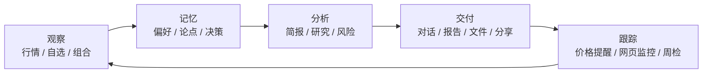
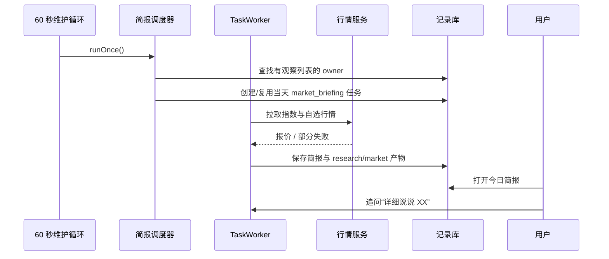
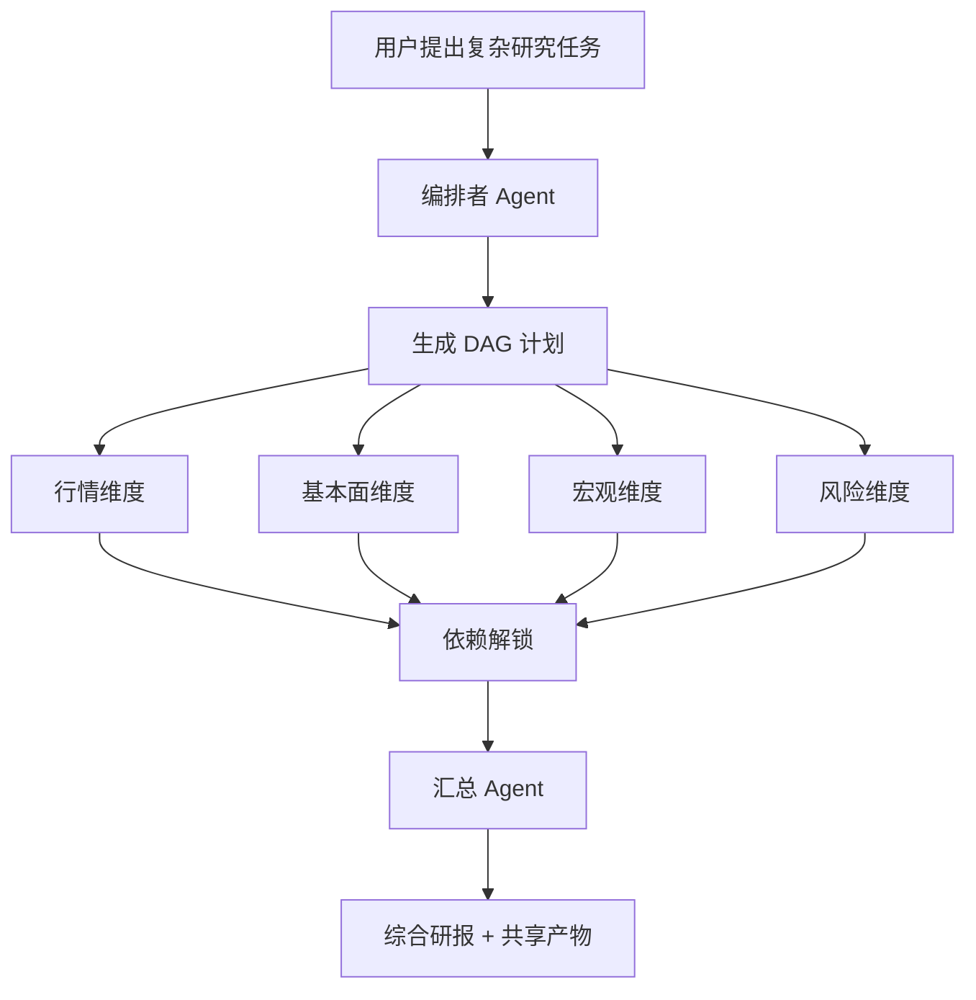
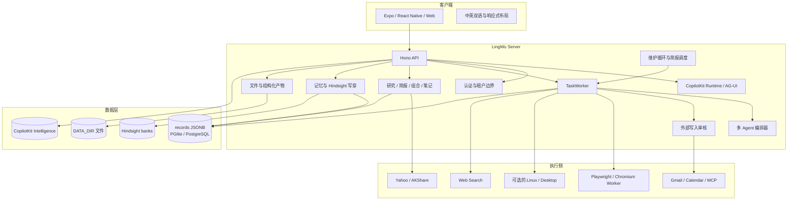
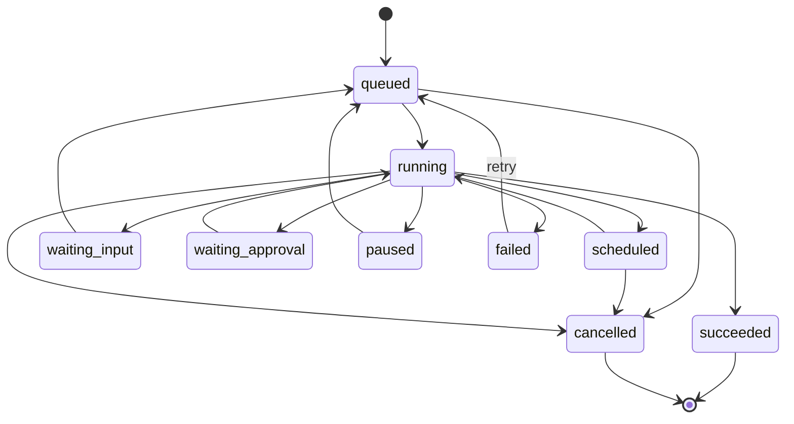
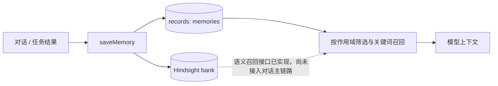

# LingWu（灵悟）：个人投研智能体

> **一句话介绍**：灵悟不是一个只负责回答问题的股票聊天机器人，而是一名带着行情、浏览器、文件、任务队列和长期记忆工作的个人投研助理。你把研究目标交给它，它负责收集信息、形成计划、持续跟踪，并把可复核的结果交付回来。

**文档定位**：产品与架构全景 ｜ **当前版本**：`0.1.0-alpha` ｜ **更新日期**：2026-11-16

**相关入口**：[项目 Wiki](WIKI.md) ｜ [主 README](../README.md) ｜ [产品需求](PRD-LingWu-个人投研智能体.md) ｜ [功能清单](FEATURES.md) ｜ [路线图](../ROADMAP.md)

---

## 0. 一分钟了解

### 0.1 它解决什么问题

个人投研最耗时的部分，通常不是“看一条行情”，而是把分散的信息连成一条可复用的研究链路：

| 日常动作 | 真实成本 | 灵悟承担的工作 |
| --- | --- | --- |
| 早上看隔夜市场 | 在多个 App 间切换，重复摘录 | 按日生成市场简报，汇总主要指数与自选标的异动 |
| 研究一家公司 | 找行情、读新闻、找同业、做估值、整理结论 | 创建耐久研究任务，产出结构化研报与可下载产物 |
| 管理持仓 | 手工维护 CSV，计算市值、盈亏和风险 | 导入持仓、按币种汇总、计算配置与风险指标 |
| 跟踪判断 | 靠记忆或散落笔记，事后难复盘 | 论点笔记、周检记录、按 Agent/频道隔离的记忆 |
| 等一个变化 | 反复刷新网页或行情 | 价格提醒与公开网页条件监控，启用后由后台持续检查 |
| 多专家协作 | 一个人切换多种分析视角 | 频道内多 Agent 编排，按 DAG 分工后汇总 |

### 0.2 产品闭环



灵悟的价值不只在单次答案，而在把 **观察、记忆、分析、交付、跟踪** 连成可持续的工作循环。

### 0.3 三条产品边界

1. **做研究辅助，不做投资建议**：输出是信息整理、分析和待复核草稿，不构成买卖建议。
2. **做持续跟踪，不做交易执行**：当前不接券商下单，不代用户买卖证券。
3. **做可追溯交付，不伪造证据**：行情、新闻、文件和页面内容都作为有来源的数据处理；缺失时明确降级，不编造数据或成功回执。

---

## 1. 产品定义

### 1.1 目标用户

| 用户类型 | 典型任务 | 灵悟提供的帮助 |
| --- | --- | --- |
| 个人股票投资者 | 跟踪 A 股、港股、美股自选；阅读公告与新闻 | 自选行情、标的简报、单标的研究、条件监控 |
| 长期价值研究者 | 建立投资论点，持续验证关键假设 | 论点笔记、证据整理、周检提醒、长期记忆 |
| 组合型投资者 | 维护多市场、多币种持仓，关注集中度与回撤 | CSV 导入、资产配置、分币种风险指标 |
| 研究型用户 | 需要把研究过程沉淀为报告和资料库 | 耐久任务、结构化产物、HTML/PDF 交付、分享 |
| 多角色协作者 | 希望同时获得行情、基本面、宏观、风控视角 | Agent 模板、频道群聊、多 Agent DAG 编排 |

### 1.2 灵悟不是什么

- 不是实时行情终端，不承诺交易所级实时性。
- 不是自动选股器或收益保证工具。
- 不是券商交易系统，不提供下单、撤单、资金划转。
- 不是无边界爬虫，不绕过登录、付费墙或访问控制。
- 不是“有问必答”的万能助手；没有配置的数据源、连接器或模型会明确报错或要求补充配置。

### 1.3 设计原则

1. **目标是入口，而不是提示词**：用户描述希望得到的结果，系统负责拆解为计划、任务和产物。
2. **过程可见**：计划、步骤、等待输入、审批、失败和重试都保留在执行记录中。
3. **数据有边界**：不同账户、Agent、频道之间的记忆和工作区隔离；外部写入走独立审核。
4. **降级要诚实**：数据源失败时返回部分结果、缓存或明确错误，不用示例值冒充真实行情。
5. **结果可复用**：报告、简报、组合分析和对话产物进入文件库，可继续引用、分享或导出。

---

## 2. 核心能力地图

状态说明：**已实现**表示当前代码与界面可用；**部分实现**表示主链路可用但存在明确边界；**规划中**表示尚未作为当前能力对外承诺。

### 2.1 投研工作台

| 能力 | 状态 | 当前实现 |
| --- | --- | --- |
| 每日市场简报 | **已实现** | 汇总标普 500、纳斯达克、道指、上证、深证及自选标的；3–5 条要点；按日幂等；可定时或手动生成 |
| 观察列表 | **已实现** | 多列表管理；单列表最多 200 个标的；行情摘要有整体超时；日涨跌幅绝对值 ≥ 2% 标记为异动 |
| 标的搜索与行情 | **已实现** | Yahoo Finance 为主；A 股可回落到 AKShare；60 秒新鲜缓存、5 分钟过期缓存降级 |
| 单标的深度研究 | **部分实现** | 行情、近期新闻、固定同业组、52 周区间启发式估值；尚未接入完整财报、一致预期和 DCF |
| 投资组合 | **已实现** | CSV 预览/导入、手工持仓、成本/市值/浮动盈亏/占比、按币种资产配置 |
| 组合风险 | **已实现** | Beta、Sharpe、年化收益/波动、最大回撤、基准对比；不同币种不混算、不做汇率折算 |
| 投资笔记 | **已实现** | 买入理由、卖出理由、研究笔记、论点四类；可按标的、类型、关键词筛选 |
| 论点周检 | **部分实现** | 每周幂等记录、通知和人工状态更新；自动检查只标记“待人工确认”，不伪造结论 |
| 价格提醒 | **已实现** | 价格高于/低于、日内涨跌幅阈值；1–1440 分钟检查间隔；24 小时通知去重 |
| 网页条件监控 | **已实现** | 内容变化、包含文本、价格低于阈值；支持间隔、每日、每周；失败指数退避，连续失败后暂停 |
| 市场事件日历 | **规划中** | 简报中的 `events` 当前明确标记为未接入；空数组不代表“今天没有事件” |

### 2.2 Agent 与协作

| 能力 | 状态 | 当前实现 |
| --- | --- | --- |
| 对话与任务委派 | **已实现** | CopilotKit headless 对话、AG-UI 流式事件、任务可在 App 关闭后继续运行 |
| 多 Agent 空间 | **已实现** | 空间总计最多 20 个 Agent，其中 1 个系统 Agent；行情、资产、研究、财报、宏观、风控、复盘、自定义等模板 |
| 独立模型选择 | **已实现** | Agent 可绑定独立模型；个人模型连接优先于部署默认值 |
| 频道群聊 | **已实现** | 2–10 名成员；共享目标与指令；可附带资料、分析产物和已连接连接器 |
| 多 Agent 编排 | **已实现** | 编排者把任务拆成最多 50 个节点的 DAG；依赖解锁、失败传播、结果汇总 |
| 主动建议 | **已实现** | 带证据的建议卡；可编辑、采纳或忽略；与任务和通知衔接 |
| 技能库 | **已实现** | 184 条内置只读技能元数据 + 账户级自建 Markdown 技能；运行时不执行技能脚本 |
| 应用连接器 | **部分实现** | 研究数据、搜索、办公、文档、文件、邮件等 MCP/内置通道；部分 OAuth 连接仍需外部回调配置 |

### 2.3 执行与交付

| 能力 | 状态 | 当前实现 |
| --- | --- | --- |
| 耐久任务 | **已实现** | SQL 租约、心跳、检查点、暂停/恢复/取消/重试、输入请求、失败记录 |
| 外部写入审核 | **已实现** | 邮件发送与日历变更先生成独立审核单；模型不能自行批准 |
| 浏览器 | **已实现（需配置）** | Playwright + Chromium、持久化 profile、页面读取、截图/接管、PDF 下载 |
| 智能体计算机 | **已实现（可选）** | Docker Linux 工作区或 E2B Desktop；命令回执、文件编辑、PDF 导入导出 |
| 文件库与产物 | **已实现** | 上传、PDF/HTML/图片预览、下载、分析产物、HTML 导出、网页打印为 PDF |
| 分享 | **已实现** | 对话、简报、报告生成公开链接；独立持久化，避免数据目录重建后全部失效 |
| 设备推送 | **规划中** | 当前为应用内通知收件箱；APNs/FCM 尚未接入 |
| 语音与会议纪要 | **规划中** | 尚无语音输入、转写和纪要归档主链路 |

### 2.4 账户与安全

| 能力 | 状态 | 当前实现 |
| --- | --- | --- |
| 单用户模式 | **已实现** | 共享访问密钥保护一个工作区，适合自托管与单机使用 |
| 多用户模式 | **已实现** | Supabase 邮箱注册/登录、验证码登录、JWT 会话、多设备会话与远程登出 |
| 账户隔离 | **已实现** | 业务记录按 owner 隔离；浏览器 profile 与计算机实例按账户隔离 |
| 凭据保护 | **已实现** | 模型密钥、Google/连接器凭据服务端加密；密钥不回传客户端 |
| 操作审计 | **已实现（Supabase 模式）** | 登录与资源操作写入审计日志；未配置 Supabase 时跳过旁路审计 |

---

## 3. 典型工作流

### 3.1 晨间简报：先看结论，再决定是否追问

**用户动作**

1. 在观察列表中加入自己关注的标的。
2. 在设置中启用每日简报调度。
3. 早上打开应用，查看简报；需要时直接追问某只标的。

**系统链路**



**当前边界**

- 调度按 UTC 整点执行，默认 `00:00 UTC`，即北京时间 08:00。
- 只给“有观察列表”的账户自动建任务；没有观察列表时可手动生成。
- 启用 `BRIEFING_SCHEDULE_ENABLED=true` 才会自动运行。
- 今日事件尚未接入，简报正文会明确标注数据缺口。

### 3.2 单标的研究：从代码到可打开的报告

**输入**

```text
研究一下 AAPL
研究一下 600519
研究一下 0700.HK
```

**执行步骤**

1. 归一化标的代码，例如 `600519.SH` → `600519.SS`、`00700.HK` → `0700.HK`。
2. 获取最新报价；主报价失败时任务失败，不生成假报告。
3. 查询标的名称与行业；若查不到，以代码作为标题兜底并写入风险项。
4. 通过搜索服务收集最多 5 条近期新闻；搜索失败时保留空新闻并标注原因。
5. 查询预置同业组；未配置的标的返回空对比，不临时编造同业。
6. 用 52 周高低区间生成启发式估值区间；缺少区间时使用当前价 ±10% 作为明确标注的占位值。
7. 生成六段式报告：公司概况、财务字段、新闻、同业、估值、风险。
8. 保存 `research_report` 产物，并把报告写入 `research_reports` 记录。
9. 在标的详情页展示；Web 端可打印为 PDF，移动端可分享 HTML 后用系统打印。

**准确性说明**

当前研究链路是 **P0 研究底稿**，不是完整卖方研报：

- 不包含完整三大报表、盈利预测、一致预期和 DCF。
- 估值是区间启发式，不能当作目标价。
- 新闻与同业失败会显式降级；报告中的 `unavailable` 字段列出缺失项。
- 所有报告均带“不构成投资建议”提示。

### 3.3 组合分析：先分币种，再谈风险

**导入**

- 手动添加持仓，或上传 CSV。
- CSV 预览会逐行校验标的、数量、成本价、买入日期、市场与币种；合法行可先导入，错误行单独返回。
- 同一 CSV 内容在 24 小时内重复导入会标记为重复，避免重复记账。

**汇总**

- 原币成本、现价、市值、浮动盈亏、盈亏比例。
- 按标的、行业、市场三个维度展示配置。
- 不同币种分别形成资产桶，不进行汇率折算。

**风险指标**

| 指标 | 计算口径 | 最低数据要求 |
| --- | --- | --- |
| Beta | 组合日收益对基准日收益的协方差 / 基准方差，250 日窗口 | 120 个对齐观测 |
| Sharpe | 年化超额收益 / 年化波动，252 个交易日 | 120 个对齐观测 |
| 年化收益 | 对齐区间累计净值年化 | 至少 120 个观测 |
| 年化波动 | 日收益样本标准差 × √252 | 至少 120 个观测 |
| 最大回撤 | 权益曲线峰谷跌幅 | 至少 60 个收盘点 |

基准默认按币种推导：CNY → 沪深 300，USD → 标普 500，HKD → 恒生指数。无风险利率由 `RISK_FREE_RATE` 配置，默认 2%。

### 3.4 论点闭环：把“我记得”变成“可回检”

1. 为标的创建 `THESIS` 类型笔记，记录一句话论点和正文。
2. 论点初始状态为 `ACTIVE`，检验结果为 `pending_confirmation`。
3. 每周维护循环生成一次幂等周检记录；同周重复运行复用旧记录。
4. 当前自动周检不会替代研究员下结论，只提示“待人工确认”。
5. 用户手动更新为 `VALIDATED`、`INVALIDATED` 或 `EXPIRED`，并保留检验来源与时间。
6. 周检结果可生成应用内通知；历史检验记录可按笔记查询。

> 设计取舍：先保证“不伪造结论”，再逐步接入模型自动回检和证据绑定。

### 3.5 频道协作：让多个专家真正分工



- 频道成员 2–10 名，每名 Agent 可以使用自己的模型、人设和技能。
- 编排者必须先调用 `submit_orchestration`，把任务拆成 DAG。
- 入度为 0 的节点先执行；依赖满足后解锁下游。
- 任一节点失败时，其下游标记为跳过，顶层任务失败并只发送一次汇总通知。
- 所有节点成功后，由汇总 Agent 合并各片段；模型不可用时降级为结构化拼接。

### 3.6 持续跟踪：把“盯着”交给后台

**价格提醒**

- 支持 `PRICE_ABOVE`、`PRICE_BELOW`、`CHANGE_PCT`。
- 每 1–1440 分钟检查一次。
- 同一提醒 24 小时内只通知一次；关闭提醒即停止检查。
- 行情不可用时保留错误和下一次检查时间，不把“取价失败”当作“未触发”。

**网页监控**

- 监控公开 HTTP(S) 页面，支持内容变化、包含指定文本、价格低于阈值。
- 支持固定间隔、每日、每周调度；每日/每周使用 `Asia/Shanghai` 解释 `timeOfDay`。
- 连续失败会指数退避；达到 5 次后暂停并通知。
- 价格阈值币种仅支持 CNY、HKD、USD，明确不做汇率换算。

---

## 4. 系统架构

### 4.1 总览



### 4.2 客户端

- **技术**：Expo + React Native + Web，CopilotKit headless hooks。
- **桌面**：三栏布局（Agent 列表 / 对话 / 能力侧栏），支持列宽调整。
- **移动**：左右抽屉、底部输入区、原生 PDF 阅读与系统分享。
- **国际化**：简体中文与英文运行期切换，偏好持久化。
- **可访问性**：减少动态效果、键盘/指针交互、可读字号与语义标签。

### 4.3 服务端

服务端采用“薄 HTTP + 厚领域服务”的结构：

| 层 | 目录 | 职责 |
| --- | --- | --- |
| 入口 | `apps/server/src/app.ts` | Hono 路由、认证、限流、CORS、错误边界 |
| 领域服务 | `apps/server/src/engine/` | 任务、研究、简报、组合、提醒、笔记、编排、记忆 |
| 运行时 | `apps/server/src/agent.ts` | CopilotKit runtime 与 AG-UI 接入 |
| 身份 | `apps/server/src/auth.ts` / `supabase-auth.ts` | 单密钥或 Supabase 账户 |
| 存储 | `apps/server/src/db.ts` | `records` 表、CAS、按 owner/kind 查询 |
| 执行 | `apps/server/src/browser.ts` / `computer.ts` | 浏览器会话、Linux/桌面工作区 |
| 连接器 | `apps/server/src/connectors/` | MCP、邮件、OAuth、文件、台账 |
| 文件 | `apps/server/src/files.ts` | 上传、PDF、签名 URL、填写与导出 |

### 4.4 持久化模型

业务数据主要存放在单表 `records`：

```sql
records(
  owner text,
  kind text,
  id text,
  data jsonb,
  updated_at timestamptz,
  primary key (owner, kind, id)
)
```

关键记录类型：

| `kind` | 内容 |
| --- | --- |
| `tasks` | 耐久任务、计划、状态、证据、产物引用 |
| `agent-artifacts` | 对话/研究/简报/组合产物 |
| `watchlists` | 观察列表 |
| `symbols` | 标的元数据 |
| `market_briefings` | 每日简报 |
| `research_reports` | 单标的研究报告 |
| `price_alerts` | 价格提醒 |
| `portfolios` / `holdings` | 组合与持仓 |
| `notes` / `thesis_checks` | 投资笔记与论点周检 |
| `monitors` / `monitor-pages` | 网页监控与页面基线 |
| `memories` | 结构化长期记忆 |
| `channels` | 频道元数据 |
| `orchestration_plans` | 多 Agent DAG 计划 |
| `run-events` / `runs` | 任务事件与执行回执 |
| `actions` | 外部写入审核单 |

这种 JSONB 快照模型适合早期快速迭代，并支持 `compareAndSwap` 乐观并发。当前还不是完整事件溯源系统；任务事件与执行回执是审计补充，不是可回放的全部事实源。

### 4.5 耐久任务状态机



运行参数：

- 1 秒轮询，单进程最多并发 3 个任务。
- 任务租约默认 60 秒，心跳按租约的 1/3 续约。
- 模型单次运行上限 5 分钟；超时或中断会回写失败/排队状态。
- 任务检查点逐段落盘，进程重启后可继续未完成工作。
- 失联租约被其他 worker 接管；旧 worker 的操作因 `LostLeaseError` 终止。

### 4.6 行情数据链路

```text
请求
  → 新鲜内存缓存（默认 60 秒）
  → Yahoo Finance
  → A 股且启用时回落 AKShare
  → 5 分钟内过期缓存（标记 stale=true）
  → 明确错误
```

细节：

- 每个标的整条 provider 链有 5 秒预算。
- 观察列表摘要整体预算 10 秒，单标的失败只影响该行。
- 简报行情阶段默认 10 秒，总预算 20 秒。
- 日线历史缓存 30 分钟，过期后在 2 小时内仍可用于风险计算。
- A 股若未安装 AKShare，会回落到 Yahoo，通常为约 15 分钟延迟。
- `/api/health` 返回 AKShare 与 PDF 解析的可用状态，部署时应先检查。

### 4.7 记忆架构

**权威存储与记忆引擎分离**



**作用域**

| 作用域 | 归属键 | 读取规则 |
| --- | --- | --- |
| 账户共享 | `default` | 所有 Agent 可读 |
| Agent 私有 | `agentId` | 仅该 Agent 执行的任务可读 |
| 频道共享 | `channelId` | 该频道成员在执行频道任务时可读 |

**记忆类型**

- `fact`：用户偏好、关注领域、明确事实。
- `thesis`：研究论点，可携带标的、市场、估值口径、时间周期等字段。
- `analysis`：分析过程与结论。
- `decision`：投资/融资决策，可携带阶段、对手方、金额、条款等字段。

**当前实现边界**

- 模型可通过 `remember_fact` 和 `write_memory` 主动沉淀。
- 任务完成时可从文本中识别投融资信号，兜底写入 `decision`。
- Hindsight 已实现 `retain`、`recall`、`deleteDocument` 客户端，并在写入时双写。
- 当前对话运行时的召回仍以本地作用域过滤 + 关键词评分为主；Hindsight 语义召回尚未成为默认读路径。

### 4.8 产物与分享

产物类型包括：

`plan`、`comparison`、`report`、`finance`、`market_briefing`、`research_report`。

交付路径：

- 对话内摘要卡 → 完整详情弹窗。
- 文件库 → HTML/Markdown 导出、PDF 原生读取、打印为 PDF。
- 分享链接 → 独立分享页，不要求访问者登录。
- 简报、报告和对话文本均有对应分享入口。

---

## 5. 数据模型速查

| 对象 | 关键字段 | 说明 |
| --- | --- | --- |
| `AgentTask` | `kind`、`status`、`plan`、`evidence`、`input`、`state`、`artifactIds` | 耐久任务与执行上下文 |
| `OrchestrationPlan` | `parentTaskId`、`nodes[]`、`dependsOn`、`status` | 多 Agent DAG |
| `Watchlist` | `name`、`symbols[]` | 最多 200 个标的 |
| `MarketBriefing` | `date`、`summary[]`、`market_data`、`data_status` | 按日唯一，支持部分数据 |
| `ResearchReport` | `symbol_code`、`sections`、`generated_at` | 六段式研究底稿 |
| `PriceAlert` | `threshold_type`、`threshold_value`、`interval_minutes` | 价格/涨跌幅条件 |
| `Portfolio` / `Holding` | `base_currency`、`quantity`、`avg_cost`、`currency` | 分币种汇总 |
| `InvestmentNote` | `symbol_code`、`type`、`status`、`check` | 论点与人工检验 |
| `Monitor` | `url`、`condition`、`schedule`、`nextCheckAt` | 公开网页条件监控 |
| `AgentMemoryV2` | `agentId`、`kind`、`financeTerms`、`dealHabits` | 结构化长期记忆 |
| `Channel` | `agentIds[]`、`description`、`instructions` | 2–10 名成员 |
| `AgentArtifact` | `kind`、`summary`、`data`、`taskId` | 可查看/导出的产物 |

---

## 6. API 地图

所有 `/api/*` 请求都经过认证、来源校验、请求体限制和全局限流。

### 6.1 健康与账户

| 方法 | 路径 | 用途 |
| --- | --- | --- |
| `GET` | `/api/health` | 运行模式、认证模式、行情/PDF 健康状态 |
| `GET` | `/api/auth/config` | 登录方式 |
| `POST` | `/api/auth/signup` | 邮箱注册 |
| `POST` | `/api/auth/signin` | 邮箱登录 |
| `POST` | `/api/auth/otp/request` | 请求验证码 |
| `POST` | `/api/auth/otp/verify` | 验证码登录 |
| `GET` | `/api/auth/me` | 当前账户 |
| `GET` | `/api/auth/sessions` | 会话列表 |
| `POST` | `/api/auth/sessions/:id/revoke` | 远程登出 |
| `POST` | `/api/auth/signout` | 当前会话登出 |

### 6.2 投研数据

| 方法 | 路径 | 用途 |
| --- | --- | --- |
| `GET/POST` | `/api/watchlists` | 列出/创建观察列表 |
| `PUT/DELETE` | `/api/watchlists/:id` | 更新/删除观察列表 |
| `POST` | `/api/watchlists/:id/symbols` | 添加标的 |
| `GET` | `/api/watchlists/:id/summary` | 批量行情与异动 |
| `GET` | `/api/symbols/search?q=` | 标的搜索 |
| `POST` | `/api/market/quotes` | 批量报价与标的行情 |
| `GET` | `/api/briefings/today` | 今日简报 |
| `GET` | `/api/briefings/latest` | 最新简报 |
| `POST` | `/api/briefings/generate` | 手动生成 |
| `POST` | `/api/research` | 创建研究任务 |
| `GET` | `/api/research/:symbol` | 最新研究报告 |
| `GET` | `/api/research/:symbol/history` | 历史报告 |
| `GET` | `/api/financials/:symbol` | 最新财报解析结果 |
| `GET/POST` | `/api/price-alerts` | 列出/创建价格提醒 |
| `POST` | `/api/price-alerts/:id/check` | 立即检查 |
| `GET/POST` | `/api/portfolios` | 列出/创建组合 |
| `POST` | `/api/portfolios/import/preview` | CSV 预览 |
| `POST` | `/api/portfolios/import` | CSV 导入 |
| `GET` | `/api/portfolios/:id/summary` | 组合汇总与风险 |
| `GET/POST` | `/api/notes` | 列出/创建笔记 |
| `POST` | `/api/notes/thesis-check` | 运行本周论点检查 |

### 6.3 Agent、频道与任务

| 方法 | 路径 | 用途 |
| --- | --- | --- |
| `GET` | `/api/agent` | Agent 工作区快照 |
| `POST` | `/api/agent/tasks` | 创建任务 |
| `POST` | `/api/agent/tasks/:id/control` | 暂停/恢复/取消/重试 |
| `POST` | `/api/agent/tasks/:id/input` | 提交缺失信息 |
| `GET` | `/api/agent/memory-hub` | 全局记忆中枢 |
| `GET` | `/api/agent/agents/:agentId/memories` | Agent 专属记忆 |
| `GET/POST` | `/api/channels` | 列出/创建频道 |
| `PATCH/DELETE` | `/api/channels/:id` | 更新/删除频道 |
| `GET` | `/api/orchestrations` | 编排计划列表 |
| `GET` | `/api/orchestrations/:id` | 单个编排计划 |
| `GET` | `/api/conversation/stream/:threadId` | SSE 对话流 |

### 6.4 文件、连接器与执行

| 方法 | 路径 | 用途 |
| --- | --- | --- |
| `POST` | `/api/files` | 上传文件 |
| `GET` | `/api/files/:id/content` | 读取文件 |
| `POST` | `/api/files/:id/fill` | 填写 PDF |
| `GET` | `/api/app-connectors` | 连接器目录与状态 |
| `POST` | `/api/app-connectors/:slug/connect` | 连接 |
| `GET` | `/api/calendars` | 日历列表 |
| `GET` | `/api/calendar/events` | 读取日程 |
| `POST` | `/api/actions` | 创建外部写入审核 |
| `POST` | `/api/actions/:id/decide` | 批准/拒绝 |
| `POST` | `/api/browsers` | 创建浏览器会话 |
| `GET` | `/api/computer` | 计算机状态 |
| `POST` | `/api/computer/commands` | 执行受限命令 |
| `POST` | `/api/shares` | 创建公开分享 |
| `GET` | `/s/:id` | 分享页面 |

---

## 7. 安全、可信与合规

### 7.1 权限边界

- 所有业务记录按 `owner` 隔离。
- 每个账户的浏览器 profile、计算机实例、模型凭据和连接器密钥互不复用。
- OAuth/API Key 在服务端加密，客户端只看到连接状态。
- 文件下载和浏览器控制台使用短期签名，不暴露长期凭据。
- 分享页只暴露用户主动发布的只读内容。

### 7.2 外部写入

邮件发送与日历变更必须经过：

1. 模型生成完整草稿。
2. 服务端保存审核单与幂等键。
3. 用户在原生界面确认。
4. 执行器调用外部提供商。
5. 保存成功、失败或结果未知的回执。

服务重启时，处于“执行中”的审核单会标记为 `outcome_unknown`，要求先核对供应商结果，避免重复发送。

### 7.3 数据与内容安全

- 模型看到的网页、文件、邮件、记忆都视为不可信数据，不得作为系统指令执行。
- 请求体上限 12 MB；上传文件上限 10 MB。
- 默认安全响应头：`nosniff`、`no-referrer`、`no-store`。
- 认证接口按 IP 与账号双维度限流。
- 浏览器 Worker 与计算机使用独立网络边界；Linux 终端默认无外网。
- 本地示例模式只允许 loopback 地址，生产必须显式使用 `WORKSPACE_MODE=live`。

### 7.4 合规表达

产品内应始终明确：

- 报告、简报、提醒和组合指标仅供研究参考。
- 数据可能延迟、缺失或来源于第三方，使用前需复核。
- 不提供买卖建议、收益承诺或交易执行。
- 对外发送内容必须由人审阅。

---

## 8. 当前限制与常见误解

| 常见预期 | 当前事实 |
| --- | --- |
| “它会自动帮我盯所有新闻和公告。” | 当前有价格提醒与公开网页条件监控；没有完整公告流、交易日历和事件级推送。 |
| “研报包含完整财务模型和 DCF。” | 当前研究是行情、搜索、同业与区间启发式的 P0 底稿。 |
| “它会用 AI 自动判定论点是否成立。” | 周检会生成待确认记录和通知，但结论需人工确认。 |
| “记忆是纯语义检索。” | 已接 Hindsight 写入，但对话主链路仍以作用域过滤和关键词召回为主。 |
| “组合收益跨币种自动换算。” | 不换算；人民币、美元、港币分别汇总。 |
| “手机上也能收到推送。” | 当前是应用内通知，设备 push 尚未接入。 |
| “它能直接下单。” | 明确不做交易执行。 |
| “所有连接器都能一键 OAuth。” | 目录已有，但部分 OAuth 回调或平台配置尚未完成；界面会显示缺失项。 |

---

## 9. 本地运行与验证

### 9.1 最小启动

```bash
pnpm install --frozen-lockfile
cp .env.example .env
npx copilotkit@latest login
npx copilotkit@latest project select
# 将 CPK_INTELLIGENCE_API_KEY 写入 .env
pnpm dev
```

另一个终端：

```bash
pnpm dev:web
```

打开 `http://localhost:8081`，API 健康检查为 `http://localhost:8787/api/health`。

### 9.2 建议验证顺序

```bash
# 类型与单元/工作流测试
pnpm typecheck
pnpm test

# 服务端与 Web 构建
pnpm build:server
pnpm build:web

# 浏览器 Worker（需 Chromium）
pnpm test:browser

# 可选 Linux 计算机（需 Docker）
pnpm test:computer
```

### 9.3 投研链路自检

1. `GET /api/health`：确认 `ok=true`。
2. 查看 `market_data.akshare.status`：A 股实时链路应为 `available`。
3. 查看 `pdf.status`：财报 PDF 解析需要 `pdftotext`。
4. 创建观察列表并拉取摘要。
5. 手动 `POST /api/briefings/generate` 生成简报。
6. 创建 `AAPL` 或 `600519` 研究任务，打开产物。
7. 导入一个小型持仓 CSV，检查分币种汇总。
8. 创建价格提醒，使用立即检查验证触发与去重。

---

## 10. 代码地图

| 关注点 | 入口文件 |
| --- | --- |
| Web/移动界面 | `apps/mobile/src/shell.tsx`、`workbench.tsx`、`screens.tsx` |
| 标的页与研究展示 | `apps/mobile/src/symbol-detail.tsx`、`research.ts` |
| 观察列表 | `apps/mobile/src/watchlist.tsx`、`watchlist-hub.tsx` |
| 组合 | `apps/mobile/src/portfolio-screen.tsx`、`portfolio-forms.tsx` |
| 任务中心 | `apps/mobile/src/task-hub.tsx`、`agent-workspace.tsx` |
| 频道与编排 | `apps/mobile/src/channels-screen.tsx`、`channel-chat.tsx`、`orchestration.tsx` |
| API 路由 | `apps/server/src/app.ts` |
| 任务引擎 | `apps/server/src/engine/worker.ts`、`service.ts` |
| 多 Agent 编排 | `apps/server/src/engine/orchestrator.ts` |
| 研究 | `apps/server/src/engine/research.ts`、`research-routes.ts` |
| 简报 | `apps/server/src/engine/market-briefing.ts`、`briefing-scheduler.ts` |
| 组合与风险 | `apps/server/src/engine/portfolios.ts`、`portfolio-risk.ts` |
| 提醒与监控 | `apps/server/src/engine/price-alerts.ts`、`service.ts` |
| 笔记与周检 | `apps/server/src/engine/notes.ts` |
| 记忆 | `apps/server/src/engine/memory-scope.ts`、`memory-recall.ts`、`hindsight.ts` |
| 行情 | `packages/integrations/src/market-data.ts` |
| 领域类型 | `packages/domain/src/agent.ts`、`channel.ts`、`orchestration.ts` |

---

## 11. 演进方向

### 11.1 让研究更深

- 接入完整财报、公告、一致预期与财报日历。
- 把估值从区间启发式升级为可复核的相对估值/DCF 模型。
- 让每条结论绑定来源、页码、抓取时间和关键数字。

### 11.2 让跟踪更准

- 增加交易日历和按用户时区的调度。
- 从价格阈值扩展到公告、财报、评级、持仓变化等事件。
- 增加打扰预算、静默期、设备推送和多渠道去重。

### 11.3 让记忆更有用

- 把 Hindsight 语义召回接入对话和任务执行主链路。
- 将论点、证据、检验记录和交易复盘连成可检索的资产账本。
- 支持记忆冲突检测、过期提示和用户可解释的召回来源。

### 11.4 让交付更像投研成品

- 报告模板、版本、差异对比和审阅状态机。
- 研报 PDF、投委会材料、客户一页纸等固定交付格式。
- 可复用的用户模板，把一次修改固化为长期口径。

---

## 12. 术语表

| 术语 | 含义 |
| --- | --- |
| **Agent** | 具有独立线程、人设、模型、技能和记忆作用域的智能体 |
| **Task** | 可持久化、可暂停、可恢复的工作单元 |
| **Artifact** | 任务或对话产生的结构化成果 |
| **Monitor** | 按计划重复检查公开网页条件的规则 |
| **Price Alert** | 对价格或涨跌幅阈值的周期性检查 |
| **Channel** | 多名 Agent 共享目标与指令的协作空间 |
| **Orchestration** | 把顶层任务拆成 DAG 并分派给多个 Agent |
| **Thesis** | 可回检的投资论点 |
| **Memory Scope** | 账户、Agent、频道三档记忆可见范围 |
| **Briefing** | 按日生成的市场概览 |

---

## 13. 延伸阅读

- [项目 Wiki](WIKI.md)：快速开始、概念模型、配置、部署与文档索引。
- [产品需求：个人投研智能体](PRD-LingWu-个人投研智能体.md)：P0/P1/P2 功能规划。
- [产品优化：从投研助手到盯盘的同事](PRD-产品优化-从投研助手到盯盘的同事.md)：从聊天转向事件驱动。
- [多 Agent 记忆系统](PRD-多Agent记忆系统.md)：记忆术语与演进方向。
- [记忆系统技术架构](记忆系统技术架构.md)：Hindsight 接入设计。
- [任务、目标与提醒](PRD-任务目标提醒.md)：目标轨道与提醒。
- [市场数据源评估](市场数据源评估报告.md)：Yahoo、AKShare、Tushare 等对比。
- [行情缓存与降级](行情数据缓存与降级策略.md)：缓存、限流与监控设计。
- [多 Agent 编排技术方案](技术方案-多Agent编排与事件溯源.md)：DAG 与事件流。
- [定时任务与部署手册](O2-定时任务与部署手册.md)：简报调度和生产检查。
- [验证与限制](VERIFICATION.md)：当前已验证范围。
